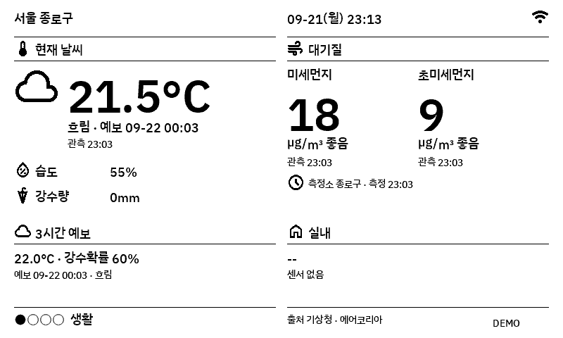
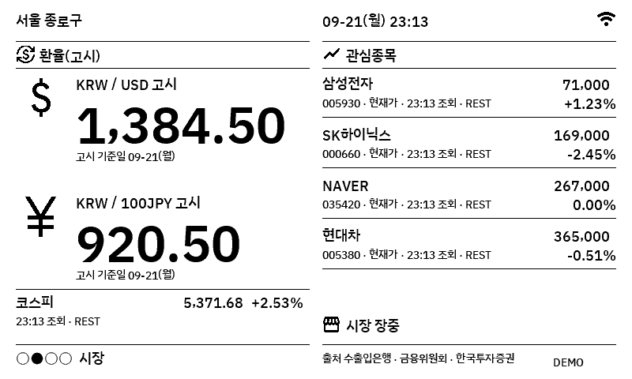
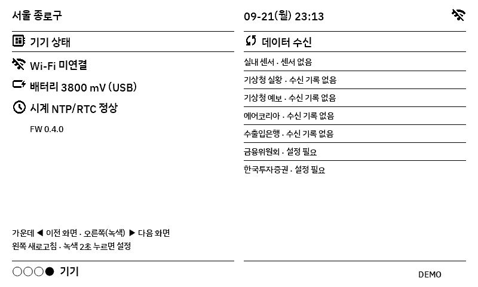

# K-Dash E1001

**서버 없이 혼자 동작하는 한국어 전자잉크 대시보드** — Seeed reTerminal E1001 한 대로 날씨·미세먼지·환율·주식·달력을 한 화면에.



> 위 화면은 PC 렌더러로 만든 샘플입니다. `DEMO` 표시가 붙은 값은 예시 데이터입니다.

- **지원 기기:** Seeed **reTerminal E1001 전용** (ESP32-S3, 800×480 흑백). E1002/E1003, 다른 ePaper 보드는 지원하지 않습니다.
- **버전:** 펌웨어 `1.0.0` ([기준 기록](docs/V1_BASELINE.md)) · **라이선스:** [MIT](LICENSE)

---

## 이런 점이 좋습니다

| | |
|---|---|
| 🖥️ **서버·클라우드 불필요** | 홈 서버, 상시 켜둔 PC, Home Assistant, 클라우드 계정 없이 기기가 Wi-Fi로 공공 API를 직접 호출합니다. |
| 📱 **휴대폰으로 설정** | Wi-Fi·지역·API 키·관심종목을 스마트폰 브라우저에서 입력합니다. 코드를 고칠 필요가 없습니다. |
| 🔍 **정직한 표시** | 모든 수치에 출처와 기준 시각이 붙습니다. 오래된 값은 `오래된 정보`, 키 미등록은 `설정 필요`, 실패는 `--`로 표시하고 0이나 가짜 값은 보여주지 않습니다. |
| 🔋 **자동 절전** | USB 전원에서는 자동 순환·재연결을, 배터리에서는 갱신할 때만 깨어나 Deep Sleep으로 절전합니다. |
| 🔒 **읽기 전용·보안** | 주문·계좌 기능은 없습니다. 모든 HTTPS 호출은 인증서 검증을 유지합니다. |

---

## 화면 4개

| 탭 | 보여주는 것 | 미리보기 |
|---|---|---|
| **생활** | 현재 기온·습도·강수·하늘, 3시간 단위 예보, 미세먼지·초미세먼지, 실내 온습도 |  |
| **시장** | USD·JPY(100) 고시환율, 관심종목 최대 4개, 코스피, 장 상태 |  |
| **달력** | 월간 달력, 공휴일·주식 휴장일·24절기, 다음 공휴일/절기 D-day |  |
| **기기** | Wi-Fi·시계·배터리·충전 보호, 공급자별 수신 상태, 설정 포털 주소·코드 |  |

---

## 빠른 시작

### 준비물
- reTerminal E1001 + 데이터 전송용 USB-C 케이블
- **2.4GHz** Wi-Fi (5GHz 전용 SSID는 보이지 않습니다)
- PC에 [PlatformIO](https://platformio.org/)와 Python 3
- (선택) 공공 API 키 — 없어도 먼저 올려서 화면과 포털부터 확인할 수 있습니다

### 1. 펌웨어 올리기
기본 환경(`reterminal_e1001`)에는 Wi-Fi나 API 키가 들어 있지 않습니다.

```powershell
pio run -e reterminal_e1001                                   # 빌드
pio run -e reterminal_e1001 -t upload --upload-port COM5      # 업로드 (COM 포트는 장치 관리자에서 확인)
```

### 2. 휴대폰으로 설정하기
1. 부팅 후 기기가 임시 Wi-Fi `KDASH-E1001-XXXX`를 열고 화면에 비밀번호를 표시합니다.
2. 휴대폰을 그 Wi-Fi에 연결하고 브라우저에서 `http://192.168.4.1/` 을 엽니다.
3. 집 Wi-Fi, 지역, API 키, 관심종목을 입력하고 저장합니다.

이후 설정을 바꾸려면 오른쪽 **녹색 버튼을 2초 길게** 누르세요. 기기 탭에 접속 주소와 **1회용 6자리 코드**가 표시됩니다.

> 처음 설치에서 막히면 [첫 플래싱 가이드](docs/14_FIRST_FLASH_GUIDE.md), 기기가 이상하면 [복구 가이드](docs/RECOVERY.md)를 보세요.

---

## 버튼

기기를 앞에서 볼 때 왼쪽 회색 2개, 오른쪽 녹색 1개입니다.

| 버튼 | 짧게 | 2초 길게 |
|---|---|---|
| 왼쪽 (회색) | 이전 화면 | – |
| 가운데 (회색) | 다음 화면 | – |
| 오른쪽 (녹색) | 수동 새로고침 | 설정 포털 열기/닫기 |

---

## 필요한 API 키

**모든 키가 필요하진 않습니다.** 원하는 기능의 키만 포털에서 넣으면 나머지는 그대로 동작합니다.

| 기능 | 출처 | 키 |
|---|---|---|
| 날씨·예보 | 기상청 | `data.go.kr` 일반 인증키 |
| 미세먼지 | 에어코리아 | 같은 `data.go.kr` 키 + 측정소명 |
| 주식 전일 종가 | 금융위원회 | 같은 `data.go.kr` 키 (활용신청 필요) |
| 공휴일 | 한국천문연구원 | 같은 `data.go.kr` 키 (활용신청 필요) |
| 환율 (USD, JPY 100) | 한국수출입은행 | 수출입은행 `authkey` |
| 주식 현재가·코스피 | 한국투자증권(KIS) | App Key + App Secret |
| 24절기, 실내 온습도 | 기기 내장 | 불필요 |

신청 링크와 주의사항은 [첫 플래싱 가이드](docs/14_FIRST_FLASH_GUIDE.md)에 있습니다.

---

## 기능 자세히

<details>
<summary><b>생활·날씨·실내 환경</b></summary>

- 기상청 초단기실황(기온·습도·강수량)과 단기예보(하늘 상태·강수 형태)를 표시합니다.
- 에어코리아 측정소 기준 PM10·PM2.5 농도와 등급을 보여줍니다. 점검·결측(`-`)은 0이 아니라 `--`로 표시합니다.
- 내장 SHT40 센서로 실내 온습도를 측정합니다 (USB 5분 / 배터리 15분).
</details>

<details>
<summary><b>금융·증시 (읽기 전용)</b></summary>

- 수출입은행 고시환율(USD, JPY 100)과 기준일. 주말·공휴일에는 직전 영업일 고시를 조회합니다.
- 관심종목 최대 4개(6자리 코드). KIS 현재가·전일 대비율 또는 금융위원회 전일 종가를 표시하며, `현재가` / `전일 종가` / `고시`를 화면에서 구분합니다.
- 국내 주요 76종목은 이름으로, 그 밖은 코드로 표시합니다.
- 일부 종목이 실패해도 나머지 종목과 코스피는 계속 수신하고 기기 탭에 실패 번호를 알려줍니다.
- 장 상태는 `장중` / `장마감` / `휴장` / `휴장 가능`으로 구분합니다.
</details>

<details>
<summary><b>달력·공휴일·절기</b></summary>

- 시계(RTC/NTP)가 검증된 경우에만 날짜와 달력을 그립니다.
- 천문연구원 특일 정보로 공휴일을, 내장 표로 주식 휴장일과 24절기(2026~2028)를 표시합니다.
</details>

<details>
<summary><b>설정 포털에서 할 수 있는 일</b></summary>

- **Wi-Fi:** 주변 2.4GHz 검색·선택, 접속 테스트 후 저장 (실패하면 기존 설정 유지)
- **지역:** 지역명, 측정소명, 기상청 격자 입력. 격자를 모르면 위도·경도로 자동 변환
- **API 키:** 필요한 키만 입력·교체·개별 삭제
- **관심종목:** 최대 4개, `KRX` / `NXT` / `통합` 시장 선택
- **기기 동작:** 시작 화면, 생활↔시장 자동 순환(1~60분), 장 시간에만 시장 탭 순환, API 호출 주기 배율(100~400%), 충전 보호
- **백업·복원·초기화:** 설정 JSON 내보내기/가져오기(비밀 값 제외), 2단계 확인 공장 초기화
- **포털 모드:** `버튼(10분)` / `상시(USB일 때)` / `끔(AP 포털만)`. 5회 오입력 시 5분 잠금, 저장된 키는 다시 표시하지 않습니다.
</details>

<details>
<summary><b>전원·절전·안정성</b></summary>

- **USB:** Wi-Fi 자동 재연결(백오프·라디오 리셋), 30초마다 갱신 기한이 된 공급자만 확인.
- **배터리:** 갱신 주기나 버튼으로 깨어나 필요한 데이터만 받고 Deep Sleep. 전압이 임계치 아래면 기기 탭만 표시하고 장시간(최대 24시간) 절전.
- **충전 보호(선택):** USB 상시 연결 시 추정 80%에서 충전 중단, 75%에서 재개. SY6974B 등 확인된 PMIC에서만 동작하며 전류 차단 스위치가 아닌 PMIC 제어입니다.
- **깜빡임·호출 절약:** 내용이 바뀌었거나 버튼 조작일 때만 전체 갱신(약 4.7초). 시계 숫자만 바뀌면 30분간 다시 그리지 않습니다. 버튼으로 화면만 넘겨도 API는 호출하지 않고, 수동 새로고침은 공급자별 120초 쿨다운이 있습니다.
- **장애 복구:** 90초 워치독, 연속 크래시 3회 시 안전 모드, 체크섬 기반 원자적 설정 저장.
</details>

---

## 하지 않는 것 · 보안

- **거래·주문·계좌 조회·자동매매·시세 재배포는 구현하지 않습니다.** 금융은 본인 기기용 읽기 전용 시세만 다룹니다.
- 중계 서버 없이 기기가 공공 API와 직접 통신하며, HTTPS 인증서 검증을 우회하거나 HTTP로 낮추지 않습니다.
- API 키·비밀번호는 로그, 화면, 설정 백업에 노출하지 않습니다.
- ⚠️ 같은 Wi-Fi 포털은 로컬 HTTP입니다. **공용·손님 Wi-Fi에서는 키를 입력하지 마세요.** NVS 저장은 기기 분실 시 하드웨어 추출까지 막아주지 못합니다. ([위협 모델](docs/11_SECURITY_THREAT_MODEL.md), [ADR 0024](docs/adr/0024-lan-settings-portal.md))
- 미구현: 애널리스트 컨센서스, 코스닥 지수, 시간대별 예보, 지하철, 음력 ([검토 문서](docs/16_NEW_TAB_IDEAS.md)), 전자잉크 부분 갱신 ([ADR 0018](docs/adr/0018-flicker-reduction-and-partial-refresh.md)), 무선 OTA ([ADR 0002](docs/adr/0002-ota-deferred.md)).

---

## 개발자용

### 개인 키로 반복 플래시
저장소 밖(`~/.config/kdash-e1001/kdash_private_credentials.h`)에 키를 두고 `reterminal_e1001_dev` 또는 `reterminal_e1001_protected_dev` 환경으로 빌드합니다. 포털로 저장한 NVS 설정이 항상 우선합니다. ([안내](docs/20_PUBLIC_REPOSITORY_GUIDE.md))

### 기기 없이 PC에서 테스트
```powershell
python -m pytest host/tests -q                     # Python 오라클·보안·도구 테스트
python tools/run_native_tests.py                   # C++ 코어 단위·통합·골든 테스트
python tools/render_previews.py --output-dir out   # 800x480 화면 미리보기 PNG
python tools/check_public_repo.py                  # 공개 전 비밀·금지 경로 검사
```
처음에는 `pio pkg install -e host_native`가 필요합니다. 로컬 전체 검증은 `scripts/ci_local.ps1` / `scripts/ci_local.sh`, 상세는 [빌드 가이드](docs/BUILD.md)를 보세요.

### 실기 검증 현황
컴파일 성공이나 PC 테스트 통과를 "실기 정상 동작"으로 부풀리지 않습니다.

| 구분 | 항목 |
|---|---|
| ✅ **실기 확인** | USB 업로드·부팅, Wi-Fi 연결과 끊김 후 약 11초 자동 재연결, 워치독 재부팅 복원, 인증서 검증을 켠 채 기상청·에어코리아·수출입은행·KIS(4종목·코스피) 수신, 한글 4계조 글꼴, 약 4.7초 전체 갱신, 시계-전용 갱신 건너뛰기(8분 관찰), 충전 보호 레지스터 제어 |
| 🟡 **PC 테스트·빌드만** | 달력 탭 실제 패널 육안, 새 버튼 배치 물리 동작, 포털 로그인 이후 전체 브라우저 E2E, 금융위원회 오후 종가 예약 수신 |
| ⛔ **미검증 (`BLOCKED_HW`)** | Deep Sleep·버튼 깨우기 100회, 배터리 소비 전류·사용 시간, 80% SOC 교정과 차단 전류 계측, USB 24h/72h/7일 연속 운용, microSD, 저온(10°C 이하) 화질, 수면 중 대기 전류 |

증거: [V1 기준점](docs/V1_BASELINE.md) · [커버리지와 갭](docs/12_COVERAGE_AND_GAPS.md) · [실 API 통합](evidence/live-api-integration/summary.md) · [장기 운영 보고](evidence/long-term-device-2026-11-13/summary.md) · [추가 안정성 플래시](evidence/followup-flash-2026-11-13/summary.md)

### 저장소 구조

| 경로 | 설명 |
|---|---|
| `src/` | 펌웨어: `app/` 사이클, `ui/` 화면·글꼴, `providers/` API 파서, `provision/` 웹 포털, `power/` 절전·충전 보호, `net/` Wi-Fi·HTTPS, `storage/` NVS, `drivers/` 전자잉크·센서·버튼 |
| `include/` | 공용 설정 타입, 인터페이스, 개발용 샘플 헤더 |
| `host/` | C++ 로직 검증용 Python 오라클과 테스트 |
| `test_native/`, `test/fixtures/` | C++ 테스트, 키를 제거한 실제 API 응답 픽스처 |
| `tools/`, `scripts/` | 미리보기, API 프로브, soak 분석, 릴리스 패키징, 공개 저장소 검사 |
| `hardware/` | E1001 핀맵, 드라이버 비교, 공식 예제 원문 |
| `docs/` | 설치·복구·운영 가이드, 설계 문서, [ADR](docs/adr/) |
| `evidence/` | 단계별 검증 보고 ([보관 규칙](evidence/README.md)) |

**문서 바로가기:** [운용 절차](docs/18_DEVICE_OPERATIONS_RUNBOOK.md) · [공개 저장소 가이드](docs/20_PUBLIC_REPOSITORY_GUIDE.md) · [출처와 미확인 질문](docs/10_SOURCES_AND_OPEN_QUESTIONS.md) · [기기 문서 재조사](docs/21_DEVICE_DOCUMENT_AUDIT_2026-11-16.md)

---

## 라이선스

소스 코드는 [MIT License](LICENSE)입니다. 글꼴(IBM Plex Sans KR, OFL-1.1)과 아이콘(Material Symbols, Apache-2.0)은 [THIRD_PARTY_NOTICES.md](THIRD_PARTY_NOTICES.md)를 따릅니다. 예시 인증 정보는 모두 플레이스홀더이며, 배터리 사용 시간이나 기기 성능은 보증하지 않습니다.

기여자·에이전트는 [AGENTS.md](AGENTS.md)와 [templates/PROGRESS_REPORT.md](templates/PROGRESS_REPORT.md)를 따릅니다.
