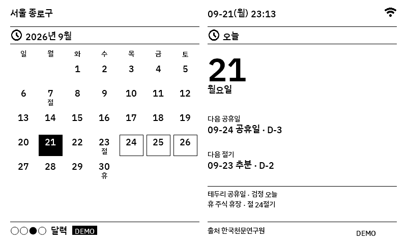

# K-Dash E1001 — 한국형 독립 실행 전자잉크 대시보드

**K-Dash E1001**은 Seeed Studio **reTerminal E1001**(ESP32-S3, 800×480 흑백 전자잉크) 한 대만으로 동작하는 **한국어 생활·증시·달력 대시보드 펌웨어**입니다.

별도의 홈 서버, 상시 켜 둔 PC, Home Assistant, TRMNL·SenseCraft 같은 클라우드 계정 없이 **기기가 Wi-Fi로 공공 API를 직접 조회하고, 화면을 그리고, 스스로 절전**합니다. Wi-Fi와 무료 공공 API 키만 준비하면 바로 사용할 수 있습니다.

> - **지원 기기:** **Seeed reTerminal E1001 전용**입니다. E1002/E1003이나 다른 ePaper 보드와의 호환은 가정하지 않습니다.
> - **현재 버전:** 펌웨어 `1.0.0` (기준 태그 `v1`, [기준 기록](docs/V1_BASELINE.md))

---

## 한눈에 보는 특징

- **서버 없는 완전 독립 동작:** 기기가 기상청·에어코리아·한국수출입은행·금융위원회·한국투자증권·한국천문연구원 API를 HTTPS로 직접 호출합니다.
- **휴대폰 웹 브라우저로 간편 설정:** 펌웨어 코드에 Wi-Fi나 API 키를 넣지 않아도 됩니다. 기기를 켠 뒤 휴대폰 브라우저에서 Wi-Fi 검색, 지역(위도·경도 자동 격자 변환 포함), API 키, 관심종목, 기기 동작 옵션을 바로 설정할 수 있습니다.
- **정직한 상태 표시:** 모든 수치에 출처와 기준 시각이 함께 표시됩니다. 오래된 데이터는 `오래된 정보` / `마지막 정상값`, 미등록 항목은 `설정 필요`, 수신 실패는 `--`로 구분하며 0이나 가짜 값을 실제 수치처럼 표시하지 않습니다.
- **전원 환경에 맞춘 자동 운영:** USB 전원에 꽂혀 있을 때는 화면 자동 순환과 Wi-Fi 자동 재연결을 유지하고, 배터리로 쓸 때는 갱신할 때만 깨어난 뒤 깊은 잠(Deep Sleep)으로 절전합니다.

---

## 제공 화면 (4개 탭)

아래 미리보기는 PC 렌더러로 생성한 샘플 화면입니다(`DEMO` 표시가 붙은 항목은 예시 데이터입니다).

| 탭 | 한눈에 보는 정보 | 미리보기 |
|---|---|---|
| **생활** | 현재 기온·습도·강수·하늘 상태, 단기예보(3시간), 미세먼지·초미세먼지 등급, 내장 SHT40 실내 온습도 |  |
| **시장** | 고시환율(USD, JPY 100), 관심종목 최대 4개(종목명·현재가·전일 대비율 또는 전일 종가), 코스피 지수, 장 상태 |  |
| **달력** | 월간 달력, 오늘 날짜, 공휴일·주식 휴장일·24절기(2026~2028) 표시, 다음 공휴일/절기 D-day |  |
| **기기** | Wi-Fi·시계·배터리 및 충전 보호 상태, 공급자별 마지막 수신 시각·오류 여부, 설정 포털 주소/코드, 버튼 안내 |  |

---

## 실제 기능 상세

### 1. 생활·날씨·실내 환경
- **실외 날씨 & 예보:** 기상청 초단기실황(기온·습도·강수량)과 단기예보(하늘 상태·강수 형태·예보 시각)를 표시합니다.
- **대기질:** 에어코리아 측정소 기준 미세먼지(`PM10`)와 초미세먼지(`PM2.5`) 농도 및 등급을 보여줍니다. 측정소 점검이나 결측(`-`) 시 0으로 오인하지 않고 `--`로 표시합니다.
- **실내 온습도:** 기기에 내장된 SHT40 센서로 실내 온도·습도를 주기적으로 측정합니다(USB 5분 / 배터리 15분).

### 2. 금융·증시 (읽기 전용)
- **고시환율:** 한국수출입은행의 `USD`, `JPY(100)` 고시환율과 기준일을 표시합니다(주말·공휴일은 직전 영업일 고시까지 조회).
- **관심종목 (최대 4개):** 6자리 종목코드를 등록하면 **한국투자증권(KIS) REST 현재가·전일 대비율** 또는 **금융위원회 전일 종가**를 표시합니다.
  - 화면에 `현재가` / `전일 종가` / `고시` 구분을 명확히 표기합니다.
  - 국내 주요 **76종목 이름**은 기기 내부 표로 바로 표시되며, 표에 없는 종목은 6자리 코드로 표시됩니다.
  - 관심종목 중 일부가 실패해도 나머지 종목과 코스피 지수는 계속 수신하고, 기기 탭에 실패한 종목 번호를 알려줍니다.
- **코스피 지수:** KIS 업종지수를 통해 코스피 지수와 등락률을 함께 보여줍니다.
- **장 상태 구분:** `장중` / `장마감` / `휴장` / `휴장 가능` 상태를 달력과 시간에 맞춰 표시합니다.

### 3. 달력·공휴일·절기
- 시계(RTC/NTP)가 검증된 경우에만 오늘 날짜와 월간 달력을 그립니다.
- 한국천문연구원 특일 정보 API로 연도별 **공휴일**을 받아 저장하고, **주식시장 휴장일**과 **24절기(2026~2028 내장 상수표)** 를 함께 표시합니다.
- 다가오는 **다음 공휴일**과 **다음 절기**까지의 D-day를 계산해 보여줍니다.

### 4. 휴대폰으로 하는 웹 설정 포털
별도의 PC 프로그램 없이 스마트폰 브라우저만으로 모든 기기 설정을 바꿀 수 있습니다.

- **초기 설정 (임시 Wi-Fi AP 모드):** 처음 켜거나 저장된 Wi-Fi가 없으면 기기가 `KDASH-E1001-XXXX` 임시 Wi-Fi를 열고 화면에 비밀번호를 표시합니다. 휴대폰을 연결한 뒤 `http://192.168.4.1/`로 접속하면 됩니다.
- **일상 설정 (같은 Wi-Fi LAN 모드):** 이미 Wi-Fi에 연결된 상태라면 오른쪽 **녹색 버튼을 2초 길게** 누르세요. 기기 탭에 접속 주소(`http://<기기 IP>` 및 `.local`)와 **1회용 6자리 페어링 코드**가 표시됩니다.
  - 포털 모드는 `버튼(10분)` / `상시(USB 전원일 때)` / `끔(AP 포털만)` 중 선택할 수 있습니다.
  - 5회 잘못 입력하면 5분간 잠기며, 저장된 API 키나 Wi-Fi 비밀번호는 화면이나 포털에 다시 노출되지 않습니다.
- **포털에서 할 수 있는 작업:**
  - **Wi-Fi 설정:** 주변 2.4GHz Wi-Fi 검색·선택 및 접속 테스트 후 저장(연결 실패 시 기존 설정 유지)
  - **지역 설정:** 표시 지역명, 에어코리아 측정소명, 기상청 격자(`nx`, `ny`) 입력 — 격자를 모르면 지도 앱의 **위도·경도**를 입력해 자동 변환 가능
  - **API 키 관리:** 필요한 서비스 키만 입력/교체/개별 삭제, 금융위원회 종가·KIS 현재가 사용 여부 토글
  - **관심종목 편집:** 최대 4개 종목 코드 입력(이름 자동 완성 지원) 및 `KRX` / `NXT` / `통합` 시장 선택
  - **기기 동작 설정:** 시작 화면, 생활↔시장 자동 순환 켜기/끄기 및 순환 간격(1~60분), 장 시간에만 시장 탭 순환(기본 KST 09~16시), API 호출 주기 배율(100~400%), **배터리 충전 보호(추정 80% 중단 / 75% 재개)**
  - **백업·복원·초기화:** 지역·관심종목·기기 설정 JSON 내보내기/가져오기(비밀 값 제외), 2단계 확인 공장 초기화(`RESET` → `RESET-YES`)

### 5. 절전·깜빡임 감소·안정성
- **USB 전원 모드:** Wi-Fi를 먼저 연결하고 끊기면 백오프·라디오 리셋으로 자동 재연결합니다. 30초마다 갱신 기한이 된 공급자만 확인하며, 설정에 따라 생활↔시장 화면을 자동 순환합니다.
- **배터리 전원 모드:** 갱신 주기나 버튼으로 깨어난 뒤 필요한 데이터만 받고 깊은 잠에 듭니다. 일반 모드는 실내 센서 재측정 때문에 최대 15분, 안전 모드는 최대 6시간입니다. 전압이 임계치 아래로 떨어지면 기기 탭만 표시하고 장시간 절전(최대 24시간)에 들어갑니다.
- **충전 보호 (선택, 지원 기기 한정):** USB 상시 연결 환경에서 포털의 `배터리 보호`를 켜면, 전압 기반 추정 80% 도달 시 충전을 중단하고 75% 이하에서 재개합니다(SY6974B 등 확인된 PMIC에 한해 동작하며 전류 차단 스위치가 아닌 PMIC 제어입니다).
- **깜빡임 및 API 호출 절약:**
  - 화면 내용이 실제로 바뀌었거나 버튼 조작·첫 화면일 때만 전자잉크 전체 갱신(약 4.7초)을 실행합니다. 시계 숫자만 바뀐 경우는 30분 동안 다시 그리지 않습니다. 검증된 시각과 CRC 보호된 렌더 상태가 있으면 Deep Sleep 뒤에도 이 간격을 유지합니다. 실제 전류 절감량은 미측정입니다.
  - 버튼으로 화면을 넘겨도 API를 추가 호출하지 않으며, 수동 새로고침에는 공급자별 120초 쿨다운이 있습니다.
  - 키 하나가 인증 오류를 내면 해당 공급자만 멈추고 하루 1회만 재시도합니다(설정을 다시 저장하면 즉시 재시도).
- **장애 복구:** 90초 태스크 워치독, 연속 크래시 3회 시 자동 안전 모드(기기 탭에 사유 표시), 원자적 설정 저장(체크섬·이전 설정 보존)을 갖추고 있습니다.

---

## 버튼 조작법

기기를 앞에서 보았을 때 **왼쪽 회색 버튼 2개, 오른쪽 녹색 버튼 1개** 기준입니다. ([ADR 0021](docs/adr/0021-button-layout-nav-gray-action-green.md))

| 버튼 | 짧게 누르기 | 2초 길게 누르기 |
|---|---|---|
| **왼쪽 (회색)** | 이전 화면 | - |
| **가운데 (회색)** | 다음 화면 | - |
| **오른쪽 (녹색)** | 수동 새로고침 | 설정 포털 열기 / 닫기 |

---

## 필요한 데이터 출처와 키

모든 키를 다 발급받을 필요는 없습니다. **키가 없는 상태로 먼저 펌웨어를 올려 부팅·화면·포털부터 확인**한 뒤, 필요한 키만 포털에서 추가해도 나머지 기능은 정상 동작합니다.

| 화면 항목 | 데이터 출처 | 필요한 인증 키 | 기본 갱신 주기 |
|---|---|---|---|
| 현재 날씨(실황) | 기상청 초단기실황 | 공공데이터포털(`data.go.kr`) 일반 인증키 | 매 정시 발표 후 |
| 단기예보 | 기상청 단기예보 | 위와 같은 키 | 발표 회차별(하루 8회) |
| 미세먼지·초미세먼지 | 에어코리아 측정소별 실시간 | `data.go.kr` 키 + 측정소명 | 1시간(USB) / 2시간(배터리) |
| 고시환율 (USD, JPY 100) | 한국수출입은행 환율 Open API | 수출입은행 `authkey` | 12시간(USB) / 24시간(배터리) |
| 주식 전일 종가 | 금융위원회 주식시세정보 V2 | 같은 `data.go.kr` 키 + 활용신청 | 평일 13시 이후 1회(최초 1회 포함) |
| 주식 현재가·등락률·코스피 | 한국투자증권(KIS) REST Open API | KIS App Key + App Secret | 장중 5분(USB) / 15분(배터리), 마감 후 1회 |
| 공휴일 | 한국천문연구원 특일 정보 | 같은 `data.go.kr` 키 + 활용신청 | 연 1~2회 |
| 24절기 | 기기 내장 상수표(2026~2028) | 불필요 | 호출 없음 |
| 실내 온습도 | 기기 내장 SHT40 센서 | 불필요 | 5분(USB) / 15분(배터리) |

> API별 상세 신청 링크와 주의사항은 **[첫 플래싱 가이드](docs/14_FIRST_FLASH_GUIDE.md)** 에 정리되어 있습니다.

---

## 시작하기 (설치 및 첫 설정)

### 준비물
- Seeed Studio **reTerminal E1001**
- 데이터 전송이 가능한 **USB-C 케이블**
- **2.4GHz Wi-Fi** (5GHz 전용 SSID는 ESP32-S3에서 보이지 않습니다)
- PC 환경: [PlatformIO](https://platformio.org/), Python 3

### 1단계: 기본 펌웨어 빌드 및 USB 업로드
기본 배포 환경(`reterminal_e1001`)에는 Wi-Fi나 API 키가 포함되지 않습니다.

```powershell
# 1. 펌웨어 빌드
pio run -e reterminal_e1001

# 2. USB 연결 후 업로드 (COM 포트는 PC 장치 관리자에서 확인)
pio run -e reterminal_e1001 -t upload --upload-port COM5
```

### 2단계: 기기에서 바로 설정하기
1. 부팅 후 저장된 Wi-Fi가 없으면 기기가 임시 Wi-Fi(`KDASH-E1001-XXXX`)를 열고 화면에 비밀번호를 띄웁니다.
2. 스마트폰으로 해당 Wi-Fi에 연결한 뒤 브라우저에서 `http://192.168.4.1/`을 엽니다.
3. 집/사무실 Wi-Fi, 지역(격자 또는 위·경도), 준비된 API 키, 관심종목을 입력하고 저장합니다.
4. 이후 설정 변경이 필요하면 오른쪽 **녹색 버튼을 2초 길게** 눌러 같은 Wi-Fi 포털을 열 수 있습니다.

> - **개발용 개인 헤더 분리:** 개발 중 반복 플래시가 잦다면 [개인 설정 분리 안내](docs/20_PUBLIC_REPOSITORY_GUIDE.md)에 따라 저장소 밖(`~/.config/kdash-e1001/kdash_private_credentials.h`)에 키를 두고 `reterminal_e1001_dev`(또는 `reterminal_e1001_protected_dev`)로 빌드할 수 있습니다. (단, 포털로 저장한 NVS 설정이 항상 우선합니다.)
> - **복구가 필요할 때:** [복구 가이드](docs/RECOVERY.md)와 [빌드 가이드](docs/BUILD.md)를 참고하세요.

---

## 의도적으로 하지 않는 것 · 보안 원칙

- **거래·주문·계좌 조회 불가:** 주식 주문, 잔고·계좌번호 조회, 자동매매, 타인에게 시세 재배포 기능은 구현하지 않습니다. 금융 기능은 본인 기기용 **읽기 전용 시세**만 다룹니다.
- **클라우드·백엔드 의존 없음:** 외부 중계 서버 없이 기기가 직접 공공 API와 통신하며, 모든 HTTPS 호출에서 **인증서 검증을 유지**합니다(검증 우회나 HTTP 강등 없음).
- **미구현 항목:** 애널리스트 컨센서스(무료 공식 API 없음), 코스닥 지수·시간대별 예보·지하철·음력([검토 문서](docs/16_NEW_TAB_IDEAS.md) 참고), 전자잉크 부분 갱신(4계조 글꼴 호환성, [ADR 0018](docs/adr/0018-flicker-reduction-and-partial-refresh.md)), 무선 OTA 업데이트(USB 업데이트 사용, [ADR 0002](docs/adr/0002-ota-deferred.md)).
- **비밀 보호 경계:** API 키·비밀번호는 로그나 화면·설정 백업에 노출하지 않습니다. 다만 같은 Wi-Fi 포털은 로컬 HTTP를 사용하므로 공용·손님 Wi-Fi에서는 키를 입력하지 마세요([ADR 0024](docs/adr/0024-lan-settings-portal.md), [위협 모델](docs/11_SECURITY_THREAT_MODEL.md)). 또한 NVS 저장이 기기 분실 시 하드웨어 추출까지 막아주지는 않습니다.

---

## PC 테스트 · 미리보기 · 검증 현황

하드웨어가 없어도 PC에서 파서·스케줄·포털·렌더링 로직을 검증하고 4개 화면 PNG 미리보기를 생성할 수 있습니다.

```powershell
python -m pytest host/tests -q                     # Python 오라클 및 보안·도구 테스트
python tools/run_native_tests.py                   # C++ 코어 단위·통합·골든 테스트
python tools/render_previews.py --output-dir out   # 기기 없이 800x480 화면 미리보기 PNG 생성
python tools/check_public_repo.py                  # 공개 전 비밀/금지 경로 인덱스 검사
```

### 실기 검증 현황 (정직성 원칙)
컴파일 성공이나 PC 테스트 통과를 "실기 정상 동작"으로 부풀려 적지 않습니다.

- **실기(E1001)에서 확인된 항목:**
  - USB 업로드·정상 부팅, Wi-Fi 연결 및 끊김 후 약 11초대 자동 재연결, task watchdog 재부팅 후 reset guard 복원
  - HTTPS 인증서 검증을 켠 채 기상청 실황·예보, 에어코리아, 수출입은행 환율, KIS 현재가(4종목)·코스피 지수 수신
  - 한글 4계조 글꼴 출력, 약 4.7초 전체 갱신 반복, 시계-전용 갱신 건너뛰기(8분 관찰), 충전 보호 레지스터 제어(`cfg`/`status` readback)
- **PC 테스트·빌드로만 확인(실기 육안·장기 미완료):**
  - 달력 탭 실제 패널 육안 확인, 새 버튼 배치 물리 동작, LAN 포털 로그인 이후 전체 브라우저 E2E 흐름, 금융위원회 오후 종가 예약 수신
- **아직 검증하지 못한 항목 (`BLOCKED_HW`):**
  - Deep Sleep·버튼 깨우기 반복(100회), 배터리 소비 전류 및 실제 사용 시간, 80% SOC 교정 및 실제 차단 전류 계측, USB 24h/72h/7일 장기 연속 운용, microSD 삽입 상태
  - 저온(10°C 이하) 화질, 수면 중 핀 상태에 따른 대기 전류 ([기기 문서 재조사](docs/21_DEVICE_DOCUMENT_AUDIT_2026-11-16.md))

자세한 증거는 [V1 기준점](docs/V1_BASELINE.md), [커버리지와 갭](docs/12_COVERAGE_AND_GAPS.md), [실 API 통합 증거](evidence/live-api-integration/summary.md), [장기 운영 실기 보고](evidence/long-term-device-2026-11-13/summary.md), [추가 안정성 플래시 보고](evidence/followup-flash-2026-11-13/summary.md)에서 확인할 수 있습니다.

---

## 저장소 구조 및 상세 문서

| 폴더 / 파일 | 설명 |
|---|---|
| `src/` | E1001 펌웨어 소스 (`app/` 사이클 실행, `ui/` 화면·글꼴·아이콘, `providers/` 공공 API 파서, `provision/` 웹 설정 포털, `power/` 절전·충전 보호, `net/` Wi-Fi·HTTPS, `storage/` NVS 저장, `drivers/` 전자잉크·센서·버튼) |
| `include/` | 공용 설정 타입(`Config.h`), 인터페이스 및 개발용 샘플 헤더(`dev_credentials.example.h`) |
| `host/` | C++ 로직 검증용 독립 Python 오라클(`host/kdash`)과 테스트(`host/tests`) |
| `test_native/`, `test/fixtures/` | C++ 실행 테스트 및 키를 제거한 실제 API 응답 픽스처 |
| `tools/`, `scripts/` | 미리보기 생성기, API 프로브, UART soak 로거/분석기, 릴리스 패키징, 공개 저장소 검사 |
| `hardware/` | E1001 핀맵([board_e1001.md](hardware/board_e1001.md)), 드라이버 비교, 공식 예제 원문 |
| `docs/` | 첫 플래싱·빌드·복구·공개 저장소 가이드, 설계 문서(`00`~`20`), 결정 기록([docs/adr/](docs/adr/)) |
| `evidence/` | 단계별 검증 요약 보고서 ([공개 저장소의 증거 보관 규칙](evidence/README.md)) |

### 자주 찾는 문서
- **처음 설치해 보기:** [첫 플래싱 가이드](docs/14_FIRST_FLASH_GUIDE.md) · [빌드·테스트 가이드](docs/BUILD.md) · [복구 가이드](docs/RECOVERY.md)
- **운영·보안·공개 준비:** [기기 운용 절차](docs/18_DEVICE_OPERATIONS_RUNBOOK.md) · [공개 저장소 및 개인 설정 분리](docs/20_PUBLIC_REPOSITORY_GUIDE.md) · [보안 위협 모델](docs/11_SECURITY_THREAT_MODEL.md)
- **설계와 결정 이력:** [커버리지와 갭](docs/12_COVERAGE_AND_GAPS.md) · [기기 문서 재조사](docs/21_DEVICE_DOCUMENT_AUDIT_2026-11-16.md) · [출처와 미확인 질문](docs/10_SOURCES_AND_OPEN_QUESTIONS.md) · [ADR 목록](docs/adr/)
- **라이선스:** 이 프로젝트의 소스 코드는 [MIT License](LICENSE)입니다. 번들된 글꼴·아이콘과 외부 데이터 출처는 아래 고지를 따릅니다.
- **라이선스 고지:** [THIRD_PARTY_NOTICES.md](THIRD_PARTY_NOTICES.md) (글꼴 IBM Plex Sans KR OFL-1.1, 아이콘 Material Symbols Apache-2.0)

---

> **기여자·에이전트 안내:** 작업 규칙은 [AGENTS.md](AGENTS.md), 보고 형식은 [templates/PROGRESS_REPORT.md](templates/PROGRESS_REPORT.md)를 따릅니다. 저장소 내 예시 인증 정보는 모두 플레이스홀더이며 배터리 사용 시간이나 기기 성능은 보증하지 않습니다.
